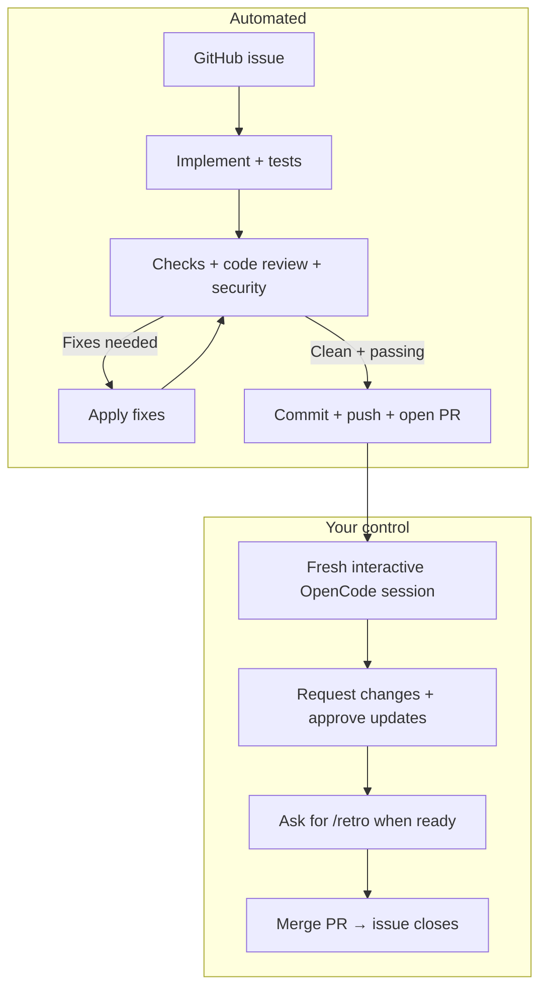

# Operarius

Take a GitHub issue from implementation to PR with OpenCode. Supports Laravel, Python, C++, Rust, and other projects.



Implementation and each review round start fresh sessions. Standards, spec, and security reviews use separate subagents. Relevant fixes are automatic; delivery requires a clean, unchanged review and passing checks within three rounds.

## Setup

Requires Linux, Bash 4+, Git, `jq`, `sha256sum`, OpenCode V2, authenticated `gh`, and your project's build/test tools.

Install your own skills and their dependencies under `~/.opencode/skills/<name>/SKILL.md`:
- Both flows: `code-review`, `retro`, and a configured `security-auditor` subagent.
- Laravel: `laravel-full-stack`, Composer, and a `composer analyse` script.
- Other languages: Matt Pocock's `tdd` and a project-specific check command.

The review skill must support uncommitted/new files and standards/spec subagents; retro must be suggestion-only. Skills and agents are not bundled.

```bash
git clone https://github.com/jcergolj/operarius.git
cd operarius
mkdir -p ~/.local/bin
ln -s "$PWD/bin/operare" ~/.local/bin/operare
```

Ensure `~/.local/bin` is on your `PATH`.

## Run

Start from your project's clean, up-to-date default branch, with an `origin` remote:

```bash
operare 123                                              # Laravel (default)
OPERARIUS_CHECK_COMMAND='python -m pytest' operare 123 --flow generic
OPERARIUS_CHECK_COMMAND='cargo test' operare 123 --flow generic
OPERARIUS_CHECK_COMMAND='cmake --build build && ctest --test-dir build' operare 123 --flow generic
```

Choose checks appropriate to your project, including required build/lint/test steps. Generic checks run in Bash from the repository root; join required steps with `&&`. Laravel always runs `composer analyse`.

## Commands

| Command / option | Purpose |
| --- | --- |
| `operare --help` | Show usage. |
| `operare ISSUE` | Implement an issue number; prompts for delivery mode. |
| `--flow laravel` / `--flow generic` | Select the flow (Laravel is default). |
| `--mode pr` | Open a PR without prompting. |
| `--mode ship` | Push directly to the default branch and close the issue; no further confirmation. |
| `--model PROVIDER/MODEL` | Override the automated phases' model. |
| `--no-watch` | Disable automated watcher windows, not the final PR handoff. |
| `operare doctor [--flow laravel\|generic]` | Check setup without AI calls or executing project checks. |
| `operare resume RUN_DIRECTORY [--no-watch]` | Retry failed initial checks using saved flow/model/checks, then review and deliver. |
| `bash RUN_DIRECTORY/pr-review.sh` | Open the saved human-led PR review session. |

Combine options after the issue number. Generic runs and doctor require `OPERARIUS_CHECK_COMMAND`. Override skill location with `OPERARIUS_SKILLS_DIR`; logs live under `${XDG_STATE_HOME:-~/.local/state}/operarius/`.

## After the PR opens

A fresh interactive session reads the handoff and waits for your instructions. Request changes, explicitly approve commits/pushes, and ask for `/retro` when ready. You merge the PR; GitHub closes the issue. Direct shipping instead runs retro automatically.

Desktop runs open a terminal; otherwise the handoff uses the current interactive terminal or prints a saved launcher. It uses normal OpenCode agent/model settings without `--auto`. Don't send instructions to automated watcher sessions.

## Safety and recovery

- Automated phases use `--auto`: trust your repository, issues, skills, and check commands. This is not a sandbox.
- Failed runs preserve changes. Only failed **initial implementation checks** support `resume`; fix them manually first. Other failures need inspection.
- A failed handoff or retro does not undo delivery. Use the saved handoff launcher; don't rerun delivery.
- Logs may contain private code and issue details. Keep them private.

## Tests

```bash
bash tests/run.sh
shellcheck bin/operare tests/*.sh
```

Tests use local Git repositories and mocked tools—no paid AI calls or network requests.
